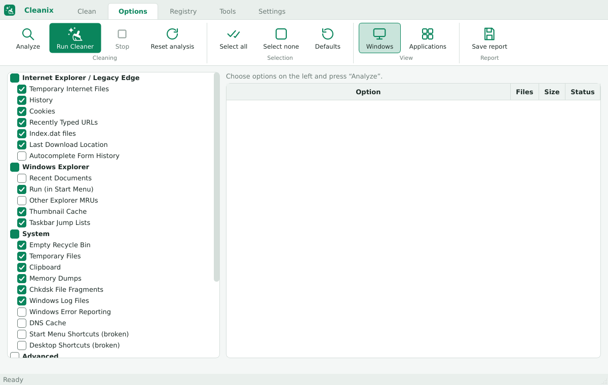
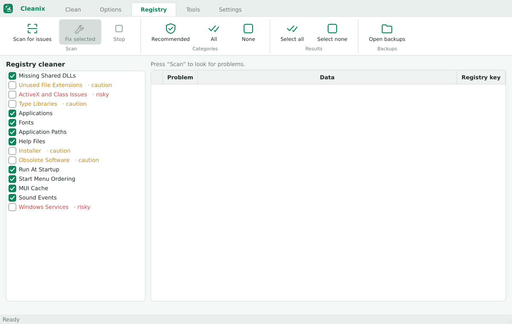
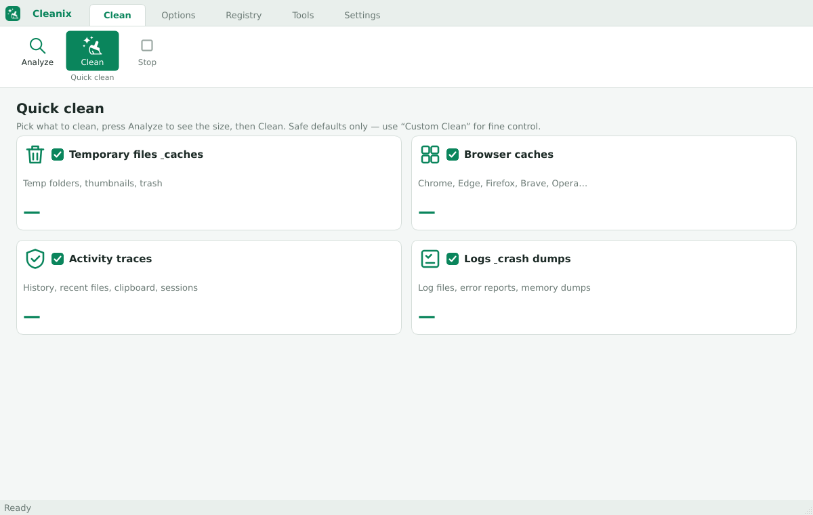

# Cleanix

Cleanix is a system cleaner for **Windows 10/11 and Linux**, inspired by the classic CCleaner layout.
It removes junk files and privacy traces, fixes registry problems, and manages startup programs and installed software.
It also finds duplicate files and analyzes disk usage, all in one window.

The interface has Explorer-style tabs on top with a ribbon of sub-commands under them.
It is available in **English and Russian**, with light and dark themes and a selectable accent color.



| Registry cleaner | Quick clean |
|---|---|
|  |  |

## Features

| Tab | What it does |
|---|---|
| **Clean** | One-click cleaning in four safe categories: temp files & caches, browser caches, activity traces, logs & crash dumps. |
| **Options** | Full option tree (Windows/System and Applications), *Analyze*, *Run Cleaner*, *Reset analysis* and a text report. |
| **Registry** (Windows) / **System issues** (Linux) | Windows: 15 registry checks, each marked *safe*, *caution* or *risky*. Only safe checks are selected by default, and a `.reg` backup is written before every fix. Entries owned by Windows (TrustedInstaller) are shown but never touched. Linux: broken launchers, orphan autostart entries, broken symlinks, stale MIME associations and dead "recent files" entries. Changed files are backed up first. |
| **Tools** | Uninstall programs (Windows registry, dpkg/rpm/pacman, Flatpak, Snap) · Startup / Scheduled tasks / Context menu / Services · Browser extensions · Disk analyzer · Duplicate finder (size + hash, to Trash or permanently) · Restore points (Windows System Restore, Timeshift, Snapper) · Free-space wiper and secure file shredder |
| **Settings** | Language, theme, accent color, deletion method (normal or 1/3/7/35-pass overwrite), file-path display, cookies to keep, extra folders to clean, exclusions, scheduling (Task Scheduler / cron) and advanced options. |

**Cleaning coverage**

- **Windows:** IE/Legacy Edge, Explorer MRUs, thumbnail cache, jump lists, Recycle Bin, Temp, clipboard, memory dumps, Windows logs, error reports, DNS cache, broken shortcuts, Prefetch, event logs and UserAssist.
- **Linux:** Trash, your own `/tmp` files older than N hours, thumbnails, font and shader caches, crash reports, clipboard, recent documents and shell history. With root it also covers journald, the package cache, rotated `/var/log` files and core dumps.
- **Browsers:** Chrome, Chromium, Edge, Brave, Vivaldi, Opera and Firefox. It cleans cache, history, cookies (with a keep-list), session, form data and passwords. Cleaning Firefox history keeps your bookmarks.
- **Apps:** pip, npm, Yarn, Cargo, VS Code, Discord, Steam, Spotify, Telegram and Microsoft Office.

## Download

Ready-made builds for Windows (`Cleanix.exe`) and Linux are attached to the [Releases](../../releases) page.
The `.exe` is not code-signed, so Windows SmartScreen may warn about an unknown publisher.

Cleanix is **portable**. Settings and registry backups are stored in a `data` folder next to the executable.
If that folder is not writable (for example, under `Program Files`), Cleanix uses the user profile instead.

Some options need administrator rights: Prefetch, event logs, services and HKLM registry fixes.
On Windows, use *Settings → Advanced → Restart as administrator*. On Linux, run it with `sudo -E`.

## Run from source

```bash
python -m venv .venv
source .venv/bin/activate          # Windows: .venv\Scripts\activate
pip install -r requirements.txt
python -m cleanix                   # GUI
```

Command-line mode, which the scheduler also uses:

```bash
python -m cleanix --list            # all options and which are selected
python -m cleanix --analyze         # how much can be freed
python -m cleanix --clean --dry-run # simulate, delete nothing
python -m cleanix --clean --silent  # clean the options selected in the GUI
```

## Build

```bash
pip install -r requirements-dev.txt
python build.py                     # dist/Cleanix.exe on Windows, dist/cleanix on Linux
```

The GitHub Actions workflow **Build** runs the tests and builds both binaries. It is started manually (*Actions → Build → Run workflow*). Filling in *release_tag*, for example `v0.1.0`, or pushing a `v*` tag publishes the binaries as a release.

## Safety

- Every option first only **finds** files (*Analyze*). Deletion happens after a confirmation, which you can turn off in Settings.
- Exclusions protect files from every option. A drive root or your home folder cannot be added as an extra folder.
- Temporary files newer than the age limit (24 h by default) are skipped.
- Cookies and Firefox history are cleaned through SQLite without losing bookmarks. Close the browser first.
- Registry fixes are preceded by a `.reg` backup in `data/backups`. If the backup fails, nothing is changed.
- The drive wiper only overwrites **free space** and keeps a safety reserve. Wiping a whole physical disk is intentionally not supported.

## Tests

```bash
pip install -r requirements-dev.txt
QT_QPA_PLATFORM=offscreen python -m pytest
```

On Linux, the tests cover cleaning logic, the registry cleaner (through an in-memory registry), startup management, duplicates, scheduling and GUI flows. They run against a fake `HOME` and registry.
CI also runs them on Windows.

## Project layout

```
cleanix/
  core/       config, i18n, cleaning engine, file helpers, registry abstraction
  catalog/    cleaning options: windows.py, linux.py, browsers.py, apps.py, custom.py
  tools/      registry/system issues, uninstall, startup, duplicates, disk analyzer, wiper, restore, plugins, cookies
  ui/         PySide6 UI: theme, icons, ribbon, pages
  scheduler.py, cli.py, __main__.py
tests/
```

## Contributing

Issues and pull requests are welcome. Run the test suite before submitting:
`QT_QPA_PLATFORM=offscreen python -m pytest`.

## Acknowledgements

Built with the help of [Claude Code](https://claude.com/claude-code).

## License

Copyright (C) 2026 shadowdark242-dev

Cleanix is free software: you can redistribute it and/or modify it under the terms of the
[GNU General Public License v3.0](LICENSE) as published by the Free Software Foundation.
It is distributed in the hope that it will be useful, but **without any warranty**, without even the implied
warranty of merchantability or fitness for a particular purpose.

Third-party components keep their own licenses: the broom icon is from Phosphor Icons (MIT), and Qt/PySide6 is under the LGPL v3.
See [THIRD_PARTY_NOTICES.md](THIRD_PARTY_NOTICES.md).
